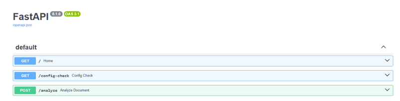

# Document Intelligence System

**Python | FastAPI | Azure AI Document Intelligence | gRPC | Protocol Buffers | Asynchronous Processing**

## Overview

This project implements a document intelligence system that extracts text from PDF files and images using Microsoft Azure AI Document Intelligence.

The application demonstrates the development of a REST API, integration with a cloud-based AI service, and distributed communication using gRPC.

The project was developed in two main stages:

1. **REST API Implementation:** A FastAPI application that accepts uploaded documents and extracts their text using Azure AI Document Intelligence.
2. **Distributed Document Processing:** An extended implementation that introduces asynchronous job management, a processing queue, and communication between FastAPI and a separate gRPC server.

The system supports PDF, JPG, and PNG documents and uses Azure's `prebuilt-read` model for optical character recognition (OCR).

## Project Objectives

- Develop a REST API for document analysis using FastAPI.
- Integrate Azure AI Document Intelligence for text extraction.
- Implement document processing using gRPC and Protocol Buffers.
- Design an asynchronous job queue for document processing requests.
- Track document processing status and retrieve extracted text.
- Explore communication between services in a distributed architecture.
- Handle invalid requests and document processing errors.

## System Architecture

The system consists of a client-facing REST API, an asynchronous job queue, a gRPC processing service, and Azure AI Document Intelligence.

**Document Processing Workflow:**

1. A client uploads a PDF or image through the FastAPI application.
2. The application validates the document type and checks that the file is not empty.
3. For asynchronous processing, the API generates a unique request ID and adds the document to a queue.
4. A background worker retrieves the queued document.
5. The worker sends the document to the gRPC processing server.
6. The gRPC server communicates with Azure AI Document Intelligence.
7. Azure extracts the document's text using the `prebuilt-read` model.
8. The processing result is returned to FastAPI and stored with the job status.
9. The client retrieves the result using the request ID.

**Architecture Diagram:**

```text
               Client / User
                     |
                     v
               FastAPI REST API
                     |
             +-------+-------+
             |               |
             v               v
      Direct Analysis   Async Job Submission
        /analyze              /jobs
             |                  |
             v                  v
     Azure Document       asyncio.Queue
      Intelligence             |
                                v
                        Background Worker
                                |
                                v
                          gRPC Client
                                |
                                v
                          gRPC Server
                          Port 50051
                                |
                                v
                    Azure AI Document
                        Intelligence
                                |
                                v
                        Extracted Text
                                |
                                v
                         Job Result
                                |
                                v
                     GET /jobs/{request_id}
```

## Technologies Used

| Technology | Purpose |
|---|---|
| Python | Main programming language |
| FastAPI | REST API development |
| Azure AI Document Intelligence | Document text extraction |
| gRPC | Communication between services |
| Protocol Buffers | Definition and serialization of gRPC messages |
| asyncio | Asynchronous job management |
| Uvicorn | ASGI server for FastAPI |
| python-dotenv | Environment variable management |
| UUID | Generation of unique processing request IDs |

## Implementation

### Part 1 – REST API with Azure Document Intelligence

The first stage implements a FastAPI application that communicates directly with Azure AI Document Intelligence.

The application supports document uploads and uses the `prebuilt-read` model to recognize and extract text.

**Main functionality:**

- Accept PDF, JPG, and PNG documents.
- Validate uploaded file types.
- Reject empty documents.
- Send documents to Azure AI Document Intelligence.
- Return extracted text in a JSON response.
- Handle errors returned by the Azure service.

The implementation is available in `main_1.py`.

### Part 2 – gRPC Document Processing Service

The second stage introduces a separate document processing service using gRPC.

The service receives document content through a Protocol Buffers message, sends it to Azure for analysis, and returns the processing result.

**Protocol Buffers messages:**

`DocumentRequest`

- `request_id` – unique document processing identifier.
- `document` – uploaded document content in bytes.

`DocumentResponse`

- `request_id` – identifier associated with the request.
- `extracted_text` – text extracted from the document.
- `status` – processing status.
- `error` – error message when processing fails.

The gRPC server uses a thread pool with a maximum of 10 workers and listens on port `50051`.

**Related files:**

- `document_service.proto`
- `document_service_pb2.py`
- `document_service_pb2_grpc.py`
- `grpc_server.py`

### Part 3 – Asynchronous Job Queue

The extended FastAPI application in `main.py` introduces job management using Python's `asyncio.Queue`.

When a document is submitted, the application creates a unique request ID and adds the document to the processing queue.

A background worker retrieves queued documents and communicates with the gRPC server.

Each job can have one of the following statuses:

| Status | Description |
|---|---|
| `waiting` | Document is waiting in the queue |
| `processing` | Document is being processed |
| `completed` | Text extraction completed successfully |
| `failed` | Document processing failed |

The application stores job information in an in-memory Python dictionary.

The background worker uses `asyncio.to_thread()` to execute the synchronous gRPC call without blocking the asynchronous event loop.

## REST API Endpoints

| Method | Endpoint | Description |
|---|---|---|
| GET | `/` | Returns an API status message |
| POST | `/analyze` | Uploads a document and returns extracted text |
| POST | `/jobs` | Submits a document for queued processing |
| GET | `/jobs/{request_id}` | Retrieves the processing status and result of a job |

### Example: Document Analysis

**Request:**

`POST /analyze`

Upload a PDF, JPG, or PNG file using the multipart form-data field `file`.

**Example response:**

```json
{
  "filename": "sample.pdf",
  "text": "Extracted document text..."
}
```

### Example: Submit an Asynchronous Job

**Request:**

`POST /jobs`

**Example response:**

```json
{
  "request_id": "example-request-id",
  "status": "waiting"
}
```

### Example: Retrieve Job Status

**Request:**

`GET /jobs/example-request-id`

**Example response:**

```json
{
  "request_id": "example-request-id",
  "filename": "sample.pdf",
  "status": "completed",
  "result": "Extracted document text...",
  "error": null
}
```

The response examples are illustrative.

## Installation and Setup

### 1. Clone the Repository

```bash
git clone https://github.com/tamyeg/document-intelligence-system.git
cd document-intelligence-system
```

### 2. Create a Virtual Environment

```bash
python -m venv .venv
```

Activate the environment.

**Windows:**

```bash
.venv\Scripts\activate
```

**Linux/macOS:**

```bash
source .venv/bin/activate
```

### 3. Install Dependencies

```bash
pip install -r requirements.txt
```

The main dependencies include:

- `fastapi`
- `uvicorn`
- `python-multipart`
- `azure-ai-documentintelligence`
- `azure-core`
- `grpcio`
- `grpcio-tools`
- `protobuf`
- `python-dotenv`

### 4. Configure Azure Document Intelligence

An Azure AI Document Intelligence resource with a valid endpoint and API key is required.

Create a `.env` file in the project directory:

```env
AZURE_DOCUMENT_INTELLIGENCE_ENDPOINT=https://your-resource.cognitiveservices.azure.com/
AZURE_DOCUMENT_INTELLIGENCE_KEY=your-api-key
```

Replace the placeholders with your Azure resource details.

**Security:** Never commit real API keys or your `.env` file to a public repository.

### 5. Run the gRPC Server

Open a terminal in the project directory and run:

```bash
python grpc_server.py
```

The server listens on port `50051`.

### 6. Start the FastAPI Application

Open another terminal and run:

```bash
uvicorn main:app --reload
```

The API is available at:

`http://127.0.0.1:8000`

Interactive API documentation:

`http://127.0.0.1:8000/docs`

For the initial REST-only implementation, run:

```bash
uvicorn main_1:app --reload
```

### 7. Test the Application

Use the interactive Swagger UI to:

1. Upload a supported document through `/analyze`.
2. Submit a document using `/jobs`.
3. Copy the returned request ID.
4. Retrieve job status through `/jobs/{request_id}`.
5. Examine the extracted text or error information.

## Limitations

The current implementation is a laboratory prototype with several limitations:

- Job information is stored in memory and is lost when the application restarts.
- The queue processes jobs through a single background worker.
- The current gRPC configuration uses an insecure local connection.
- The gRPC server address is configured as `localhost:50051`.
- Document processing depends on the availability of the Azure service.
- Azure Document Intelligence usage may incur cloud service charges.
- The implementation does not include persistent storage, authentication, or production-ready monitoring.

## Possible Future Improvements

- Implement persistent job storage using a database.
- Introduce a distributed message queue for better scalability.
- Add authentication and authorization.
- Secure gRPC communication using TLS.
- Implement retries and request timeouts.
- Containerize the application using Docker.
- Add automated unit and integration tests.
- Introduce monitoring and logging for processing performance.

## Key Learning Outcomes

This project provided practical experience in:

- Developing REST APIs with Python and FastAPI.
- Integrating cloud-based AI services.
- Implementing asynchronous workflows and background processing.
- Designing gRPC service interfaces using Protocol Buffers.
- Understanding communication between distributed services.
- Managing processing states and error handling.
- Configuring cloud service credentials through environment variables.


## Results and Demonstration

The project demonstrates document text extraction using Azure AI Document Intelligence, REST API communication, and asynchronous processing through a gRPC-based service.

### 1. REST API Interface

FastAPI provides an interactive Swagger interface for testing document analysis and job processing endpoints.



### 2. Document Text Extraction

Documents in PDF, JPG, or PNG format can be submitted through the `/analyze` endpoint.

The application uses Azure AI Document Intelligence with the `prebuilt-read` model to extract text and return it in JSON format.


### 3. Asynchronous Job Submission

Documents submitted through the `/jobs` endpoint are added to an asynchronous processing queue.

Each submission receives a unique request ID, allowing the processing status to be retrieved separately.


### 4. Document Processing Results

The `/jobs/{request_id}` endpoint provides information about the submitted job, including its status, filename, extracted text, and any processing errors.


### 5. gRPC Service

A separate gRPC server handles document processing requests sent by the FastAPI background worker.

The server communicates with Azure AI Document Intelligence and returns the extracted text and processing status to the application.


## Author

**Tamara Yegorova**

MSc Artificial Intelligence in Computer Science  
Kaunas University of Technology

[GitHub](https://github.com/tamyeg) | [LinkedIn](https://www.linkedin.com/in/tamara-yegorova/)
